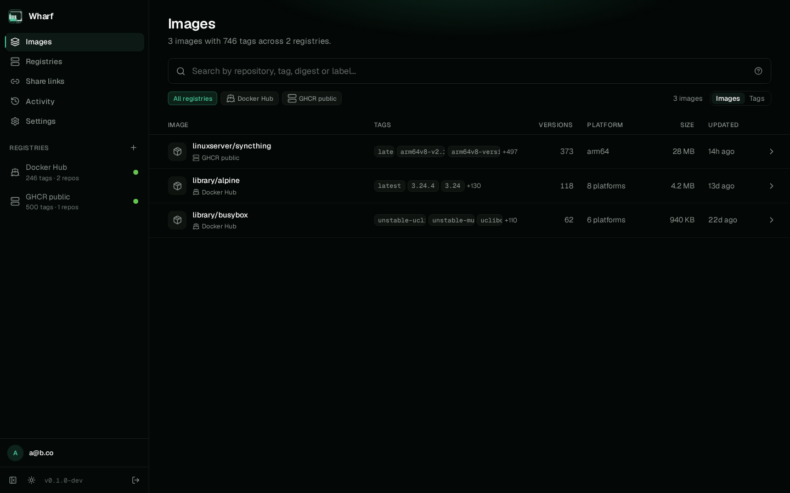
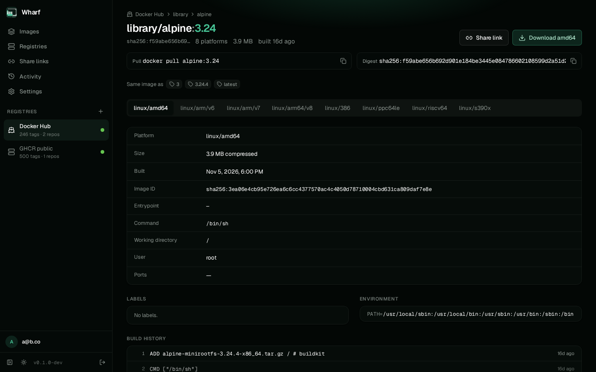
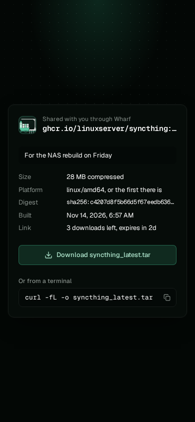

<p align="center">
  
</p>

<h1 align="center">Wharf</h1>

<p align="center">
  One place for the images in all your container registries.<br />
  Search every tag and digest across a local registry, Amazon ECR, Docker Hub, GitHub Packages, Harbor and your Docker host;<br />
  inspect them, download them for <code>docker load</code>, and send one-time download links to people without an account.
</p>

<p align="center">
  
</p>

## Features

- **Many registries, one index**: add any number of registries and Wharf syncs their repositories and tags into one searchable index, on a schedule (every 30 minutes by default) or with **Sync**.
  - **Registry**: anything that speaks the registry API: `registry:2` on `localhost:5000`, Harbor, GitLab, Gitea, Quay, Nexus, Artifactory, Azure Container Registry, Google Artifact Registry, or public `ghcr.io` images. Basic and token auth; repositories from `_catalog`, or the ones you name where the registry can't list them.
  - **Amazon ECR**: one account and region, with access keys or whatever the container has (environment, EKS IRSA, ECS task role, EC2 instance role). Signed requests to the ECR API, no AWS SDK.
  - **Docker Hub**: your namespaces with a personal access token, plus any public repositories (`nginx`, `bitnami/redis`). Listing uses Hub's API, so syncing doesn't spend your pull rate limit.
  - **GitHub Packages**: a user's or organization's container packages on ghcr.io.
  - **Docker host**: the images on the Docker Engine Wharf runs on, through its socket.
- **Images, then versions**: the Images page lists each image once, with its newest tags, how many versions it has and when it last changed. Open one to see its versions: tags on the same digest (`develop` and `a46d888c9536`) share a row. **Tags** switches back to one row per tag.
- **Search**: by repository, tag, digest or image ID (any prefix, with or without `sha256:`), Docker reference (`api:v2.*`), label, platform, or registry. `tag:v1.*`, `arch:arm64`, `label:org.opencontainers.image.source=*acme*`, `-tag:latest`. `⌘K` finds images from anywhere.
- **Inspect**: every platform of a multi-platform image: size, build date, entrypoint and command, environment, labels, ports, build history, layers and the raw manifest. Other tags on the same digest are listed alongside.
- **Download**: any image (one platform of a multi-platform one) as a tar that `docker load` and OCI tools both read. Wharf streams it from the registry, checks every blob against its digest on the way, and sends the exact size so browsers show progress.
- **Share links**: a download link for one image that works without signing in, until it expires, has been used a set number of times, or you revoke it: one-time links by default. Pin the link to today's digest or let it follow the tag. The recipient gets a page with the image's details, a download button and a `curl … && docker load` line. Only a hash of each link is stored, and a one-time link can't be downloaded twice, even by two requests at once.
- **Delete tags** (admins), on registries that allow it: the registry API, ECR and the Docker host.
- **People**: admins manage registries, deletes, people and settings; members search, download and make share links.
- **Activity**: syncs, downloads (by person or by link), links made and revoked, and changes.
- **Encrypted credentials**: registry passwords, tokens and AWS keys are sealed with AES-256-GCM and never sent back to the browser.

## Run it

```sh
docker compose up -d
```

Then open `http://<this-host>:3060` and create the admin account. See [compose.yaml](compose.yaml) for the options; everything else is set up in the web UI.

To send share links to people outside your network, put Wharf behind your reverse proxy and set **Settings → Public address**. Only `/l/…` needs to be reachable from outside; everything else asks for a sign-in.

<p align="center">
  
  
</p>

### Environment

| Variable | |
| --- | --- |
| `WHARF_DATA_DIR` | Database and key file. `/data` in the image. |
| `WHARF_SECRET_KEY` | Master key for stored credentials. Unset: a random key in `$WHARF_DATA_DIR/secret.key`. |
| `WHARF_ADMIN_EMAIL`, `WHARF_ADMIN_PASSWORD` | Create the admin on start instead of in the setup screen. |
| `WHARF_DOCKER_HOST` | Docker Engine for the Docker host registry. Default: the local socket. |
| `WHARF_AUTH=disabled` | No sign-in at all. Only on a fully trusted network. |
| `AWS_*` | For ECR registries set to "From the environment". |

## Develop

```sh
pnpm install
pnpm dev        # http://localhost:3060
pnpm check      # types
pnpm test       # unit tests, plus sync/search/download/links against a mock registry
pnpm build
```

## License

Apache-2.0
